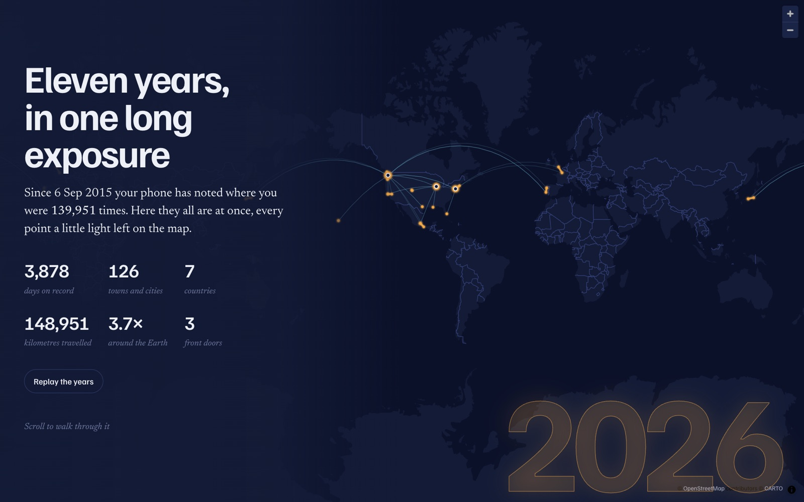
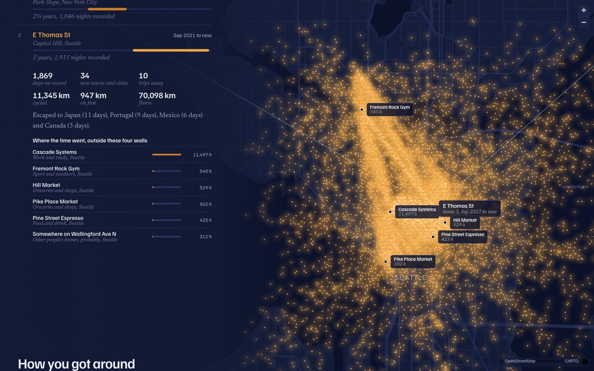
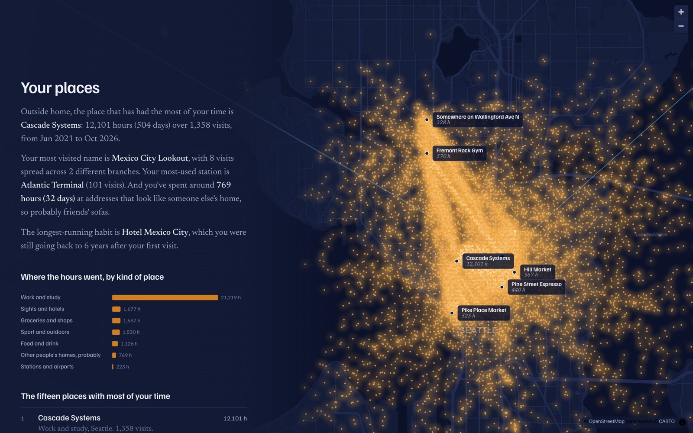
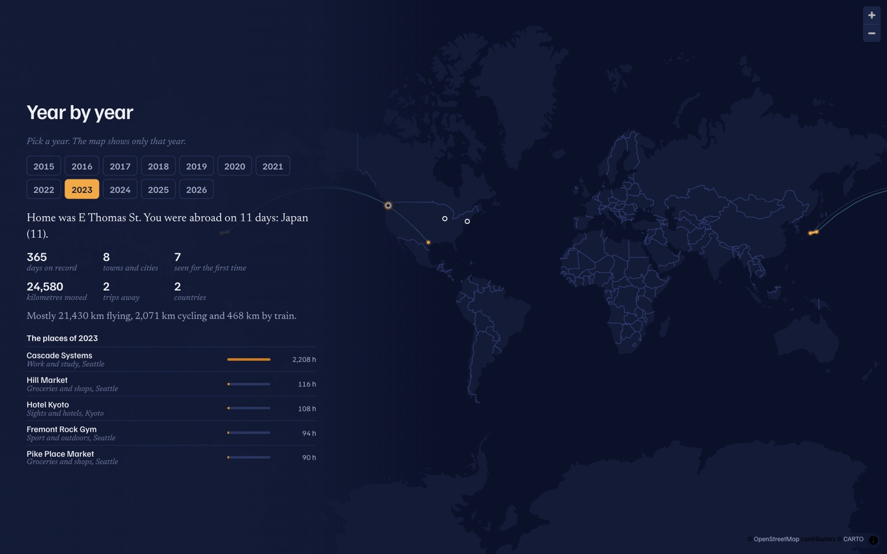
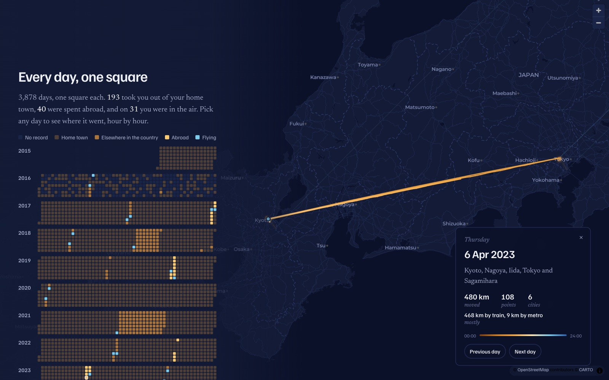

# Long Exposure

**Every place your phone remembers, in one picture.**

Google Maps has been quietly keeping a diary of everywhere you've been, sometimes for over a decade. Long Exposure turns that diary into a story you can scroll through: every point you've ever recorded glows on a night map like a long-exposure photograph, and the years unfold around it.

### [Try it now: sriharshamur.com/long-exposure](https://www.sriharshamur.com/long-exposure/)

Drop in your `Timeline.json` and you're done. No sign-up, no upload, no server. It all runs in your browser tab.



## What you get

- **The replay.** Watch your map light up one year at a time, from your first recorded point to today.
- **Your homes.** Every place you've lived, found from where you slept, with what life looked like from each one: kilometres cycled, trips taken, new towns discovered, and the places you spent the most time.
- **Your places.** The café, the gym, the office, the station, and what kind of places got your hours, with habits like "usually Saturdays around 11:00".
- **How you moved.** Kilometres flown, by train, by car, by bike and on foot, year by year, plus how many times you've gone around the Earth.
- **Your rhythm.** How much of your time was spent at home, month by month (lockdowns stand out), and an hour-by-hour map of your typical week.
- **Stamps in the passport.** Every country in the order you first visited, and which ones you only passed through.
- **Trips.** Each trip traced on the map.
- **The edges of your map.** Your furthest point north, south, east and west, the farthest you've been from home, your biggest day, and your longest walk and ride.
- **Year by year.** Pick any year to see where home was, where you went, and that year's favourite places.
- **Every day, one square.** A calendar of every recorded day. Click any square to replay that day on the map, hour by hour, then step through the days with the arrow keys.

| Life around each home | Your places |
|---|---|
|  |  |

| Year by year | Any single day |
|---|---|
|  |  |

*All screenshots use a completely made-up person who lives in Chicago, Brooklyn and Seattle. The data comes from [`examples/fake_timeline.py`](examples/fake_timeline.py).*

## Get your Timeline.json

Google now keeps your Timeline on your phone, so you export it from there.

- **Android:** open Settings, then Location, then Location services, then Timeline, and tap **Export Timeline data**.
- **iPhone:** open the Google Maps app, tap your profile picture, then Settings, then Personal content, and tap **Export Timeline data**.

Then open [the site](https://www.sriharshamur.com/long-exposure/) and drop the file in. A file with more than 10 years of history takes a few seconds.

## Your data stays yours

- Your file is read and processed **inside your browser**, in a Web Worker. Nothing is uploaded and there's no server.
- Place names come from an offline copy of [GeoNames](https://www.geonames.org/) (towns with more than 15,000 people), which ships with the site.
- **Optional:** if you choose, the site can ask [OpenStreetMap's Nominatim](https://nominatim.org/) for the real names of your homes and your 150 or so most-visited places. Only those coordinates are sent, one per second, as Nominatim's usage policy asks. You can skip this step.
- Your finished story is saved in your browser (IndexedDB) so you can come back to it, and you can delete it from the start screen at any time.
- The map background comes from CARTO and OpenStreetMap, like any other web map.

## Run it yourself

It's a static site with no build step:

```sh
git clone https://github.com/sriharshAmur/long-exposure
cd long-exposure
python3 -m http.server 8765 -d web
# open http://localhost:8765
```

### Optional Python pipeline

If you'd rather process your file from the command line, or you want the data as JSON to use in your own tools, there's an equivalent Python pipeline:

```sh
make setup                      # Python env plus GeoNames data
cp ~/Downloads/Timeline.json .  # git-ignored
make data                       # writes web/data/, which the site picks up automatically
make serve
```

- `pipeline/build.py` parses the export, geocodes it offline, and works out the homes, trips, flights, rhythm, records and per-day tracks.
- `pipeline/enrich.py` names your homes and places with Nominatim and caches every answer. To use your own names for your homes, put them in `pipeline/home_names.json` (for example `{"1": {"name": "The first flat", "hood": "Old Town"}}`).
- `make demo` regenerates the made-up demo person.

## How it works

| Piece | What it does |
|---|---|
| `web/js/process.js` | Turns the raw export into the story's data in the browser, in about a second for 190k points |
| `web/js/worker.js` | Runs that work off the main thread |
| `web/js/names.js` | Optional naming with OpenStreetMap |
| `web/app.js` | The scrolling story: MapLibre GL for the map and hand-built SVG charts |
| `web/geo/cities.json` | 31k world cities from GeoNames for offline reverse geocoding |

It works with the newer on-device Timeline format (`semanticSegments`, `rawSignals`, `userLocationProfile`), which is what phones export since Google moved Timeline off its servers in 2024.

## Credits

Made by [Sriharsh Amur](https://github.com/sriharshAmur). City data © [GeoNames](https://www.geonames.org/) (CC BY 4.0). Map tiles © [CARTO](https://carto.com/attributions), © [OpenStreetMap](https://www.openstreetmap.org/copyright) contributors. Place names from [Nominatim](https://nominatim.org/).

MIT licensed. Contributions are welcome.
